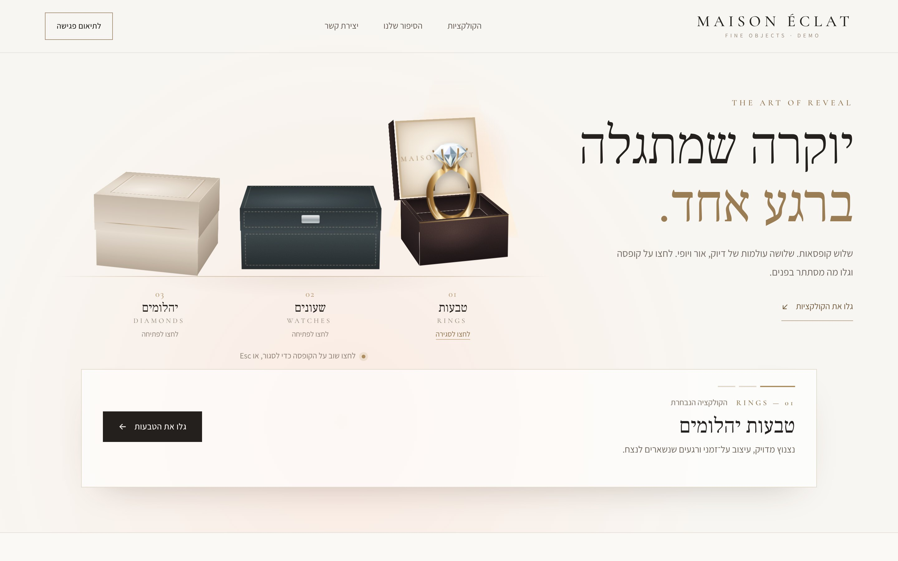
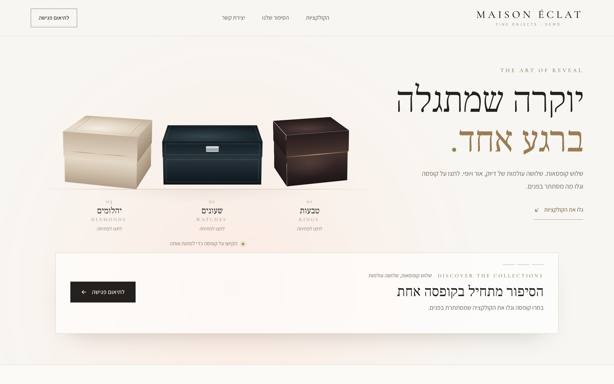
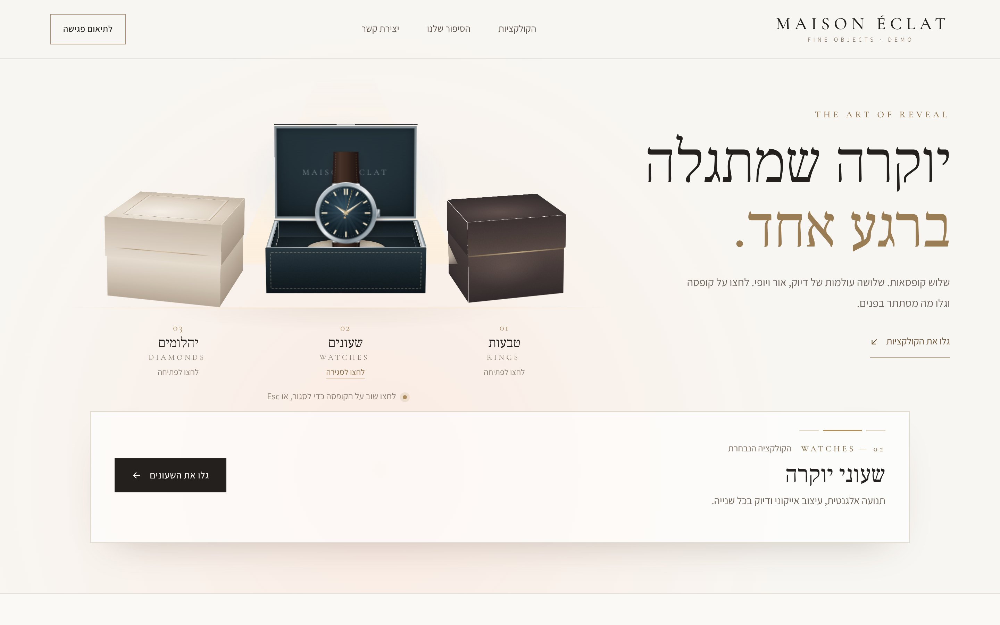
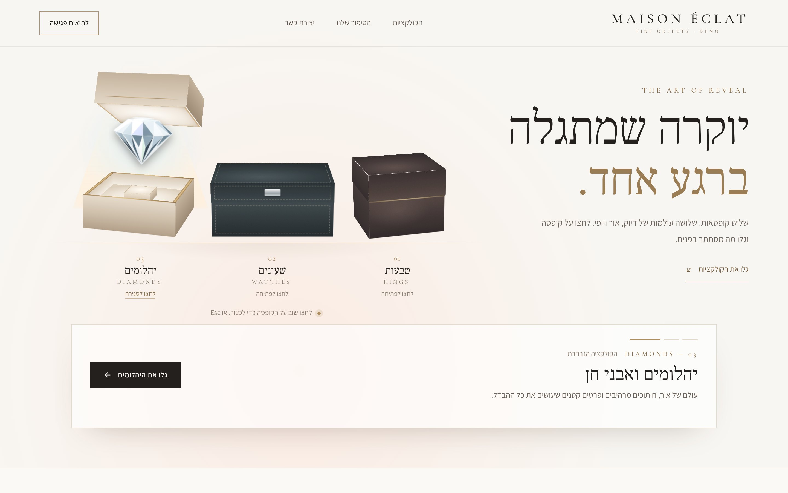
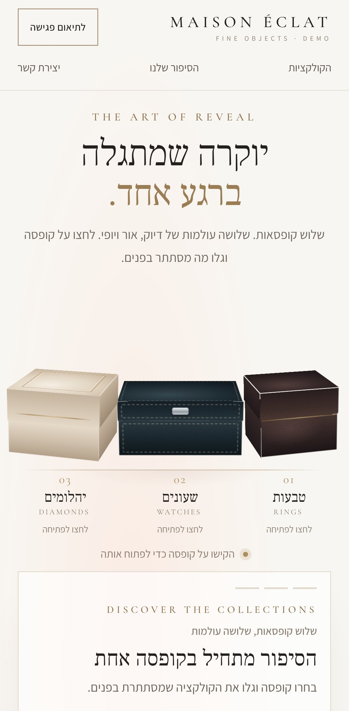
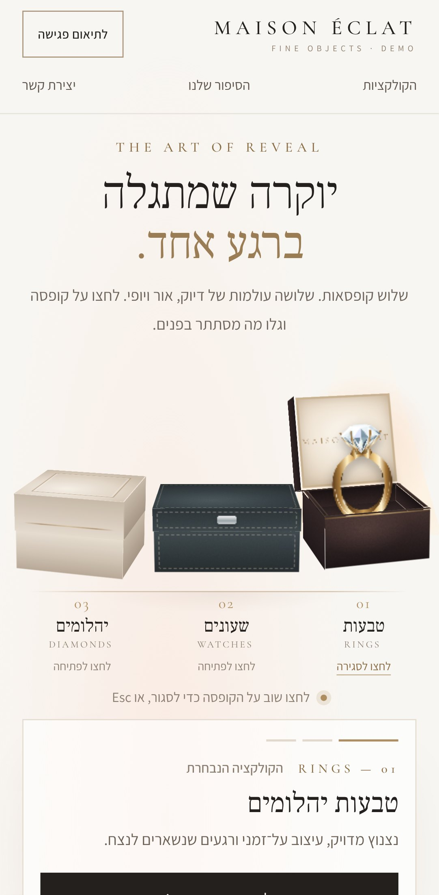
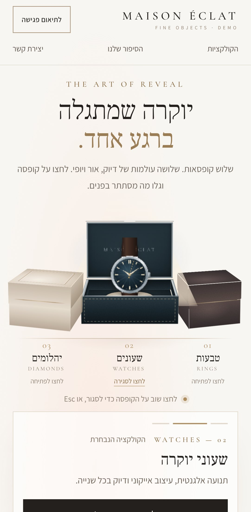
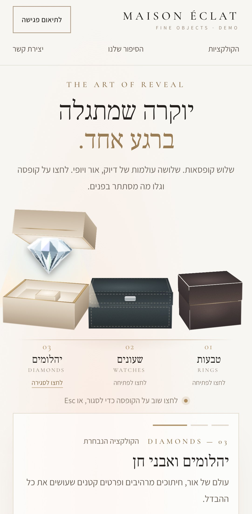

# MAISON ÉCLAT — Luxury Box Reveal (demo)

A Hebrew, RTL, mobile-first landing page for jewelry and watches, built with Next.js. The main interaction is **three luxury cases** on an ivory editorial stage:

| Case | Mechanism | Reveals |
| --- | --- | --- |
| Espresso velvet ring box | Clamshell hinge (spring settle) | Yellow-gold solitaire ring |
| Charcoal leather watch case | Heavy hinged lid, steel trim, stitching | Steel watch, midnight dial (seconds hand sweeps while open) |
| Ivory lacquered display case | Lid lifts off and floats back | Round brilliant gemstone on a pedestal |

> **Demo content.** *MAISON ÉCLAT* is a temporary placeholder brand. No trademark or domain checks have been done. The products are **original code-drawn SVG illustrations**, not product photos. The page shows no prices, stock, certifications or testimonials, and no contact channel is connected.



| Desktop closed | Watch | Diamond |
| --- | --- | --- |
|  |  |  |

| Mobile closed | Ring | Watch | Diamond |
| --- | --- | --- | --- |
|  |  |  |  |

## Quick start

```bash
npm install
npm run dev          # http://localhost:3000
```

| Script | What it does |
| --- | --- |
| `npm run typecheck` | `tsc --noEmit` (strict) |
| `npm run lint` | ESLint (`next/core-web-vitals` + `next/typescript`) |
| `npm run build` | Production build (page is statically prerendered) |
| `npm run test:smoke` | Playwright suite against `next start` (run `build` first) |
| `npm run verify` | All of the above in order |

To run the smoke tests against an already running server or a Vercel preview, set `BASE_URL=https://… npm run test:smoke`. The Playwright version is pinned to `1.63.0`. On a fresh machine, run `npx playwright install chromium` once.

## Stack and architecture

- **Next.js 15 App Router + React 19 + TypeScript (strict)**
- **Tailwind CSS v4** for tokens and base styles. Component styles live in `src/app/globals.css`.
- **CSS 3D** for the cases. Each case is a real cuboid: walls, inner lining, cushion, rim, and a lid built as a separate solid. The scene uses `perspective` and `preserve-3d`. Hinges use `transform-origin` on the back edge, so lids rotate about a physically plausible axis. Box mechanics use CSS transitions because they interpolate the `calc()`/`var(--u)` geometry and retarget smoothly on rapid clicks. There was no need for WebGL.
- **Motion for React** handles the hero entrance, the detail-panel crossfade (`AnimatePresence`) and scroll reveals. `MotionConfig reducedMotion="user"` is set.
- **Fonts**: Frank Ruhl Libre (Hebrew display), Assistant (Hebrew text) and Cormorant Garamond (Latin labels). All are OFL-licensed and self-hosted through `@fontsource`, so there are no network font fetches at build time.

```
src/
  app/            layout (lang="he" dir="rtl", metadata), page, globals.css, icon
  components/
    RevealProvider.tsx       single source of truth: none | ring | watch | diamond, Escape handling
    stage/                   CollectionsStage, LuxuryBox (3D case), Face, geometry helpers
    jewels/                  Ring/Watch/Diamond illustrations, brilliant-cut facet generator, JewelryObject
    sections/                Header, Hero, CollectionInfo, EditorialSection, ContactSection, Footer
  data/collections.ts        typed catalogue (copy, box geometry, mechanism, asset slot)
  lib/brand.ts               brand name + contact config (all null = demo mode)
  lib/reveal-state.ts        pure reducer for the 4-state machine
tests/reveal.spec.ts         Playwright smoke tests (desktop + Pixel 7 projects)
docs/                        brief, interactions, copy, QA checklist, screenshots
preview/index.html           original static concept (reference only)
.claude/skills/luxury-box-reveal/SKILL.md
```

### Interaction model
- Exactly one state: `null | "ring" | "watch" | "diamond"`. Selecting the open box closes it. Selecting another box closes the previous one and opens the new one.
- Opening runs in this order: a small lift, then the lid opens, then the product rises with a spotlight and halo, then a few one-shot glints, then the detail copy crossfades.
- Closing reverses the order: the product drops and is fully hidden (`visibility: hidden`, no ghost layer), then the lid closes.
- Each box is a semantic `<button>` with `aria-pressed`, a dynamic name (`פתיחת/סגירת קופסת …`), `aria-controls` and a visible focus ring. **Escape** closes the open box and returns focus to it. The detail panel is `aria-live="polite"`.
- `prefers-reduced-motion`: every transition is instant and the glints and seconds hand are disabled. The page stays fully functional.

### Contact / CTA
The collection CTA scrolls to `#contact`, which shows the chosen collection. While `brand.contact` in `src/lib/brand.ts` is all `null`, the section displays a clear **DEMO** notice. There is no form, no fake number and no fake success message. Fill in `whatsapp` / `email` / `phone` and real links render automatically. Add a privacy notice before collecting any data.

## Deploying a live preview on Vercel

No environment variables are required.

1. Go to <https://vercel.com/new> and import `focuswebsit-create/luxury-jewelry-landing`.
2. Framework preset: **Next.js** (auto-detected). Leave the build command as `next build` and the output as the default.
3. Click **Deploy**. Every pushed branch and PR then gets its own preview URL, and Vercel comments the link on the PR.
4. Optional check against the preview: `BASE_URL=https://<preview>.vercel.app npm run test:smoke`.

CLI alternative:

```bash
npm i -g vercel
```

```bash
vercel          # preview deployment
```

The page sets `robots: noindex` while it is a demo. Remove that in `src/app/layout.tsx` before a real launch.

## Assets that need replacing for photorealism

The illustrations are deliberately polished: they use facet-shaded brilliant cuts, multi-stop metal gradients, edge highlights and drop shadows. They are still **illustrations**. For a truly photographic result, supply rights-cleared assets (see `docs/ASSETS.md`):

| Item | Needed | Where it plugs in |
| --- | --- | --- |
| Ring | Transparent PNG/WebP, about 1200 px tall, ¾ front view, band bottom cropped where it enters the cushion | `collections[ring].asset = { type: "image", path: "/assets/ring.webp" }` |
| Watch | Transparent PNG/WebP, front view, strap running vertically, no third-party branding | same, `watch` |
| Gemstone | Transparent PNG/WebP, side/¾ view, culet down | same, `diamond` |
| Box textures (optional) | Seamless velvet, leather and lacquer textures (about 512 px) | replace the gradient/noise backgrounds in the `Materials` section of `globals.css` |
| Brand | Real name, logo, contact details, privacy policy | `src/lib/brand.ts` |

`JewelryObject` automatically renders the image instead of the SVG once `asset.type === "image"` and a `path` is set. The box mechanics don't change. For a different camera angle per product, use real GLB models with a WebGL renderer as a later phase, and keep this CSS version as the fallback.

## Testing report

**Automated (Playwright, Chromium 1243, run against the production build). Result: 23 passed, 7 skipped by design.**
- Projects: `desktop` (1280×800) and `mobile` (Pixel 7 emulation with touch).
- Covered: Hebrew/RTL/meta semantics; each box opens and closes individually with the right product and copy; open → switch → switch → close; rapid-click race (ends in one consistent state, previous products hidden); Escape plus focus restore; Tab/Enter/Space; visible focus outline; CTA goes to `#contact` with the chosen collection and an honest demo notice (no form, no WhatsApp link); touch target size; no horizontal overflow and boxes inside the viewport at 360/390/430/768/1280/1440 px, closed and open; reduced motion; **no console errors or hydration warnings** in any test.
- The skips are intentional: the width sweep runs in the desktop project only, and the keyboard test is desktop-only.

**Manual/visual:** desktop 1440×900 and mobile Pixel 7 screenshots of every closed and open state (`docs/screenshots/`), mid-animation filmstrips to check the hinge axes and switch choreography, and close-ups at 2× to tune the product materials.

**Not tested:** real iOS Safari, Firefox or physical phones (only Chromium is available in this environment); screen readers (VoiceOver/TalkBack) on real devices; Lighthouse/performance profiling on low-end devices. CSS 3D can render slightly differently in Safari and Firefox, so check a Vercel preview on a real iPhone before launch.
